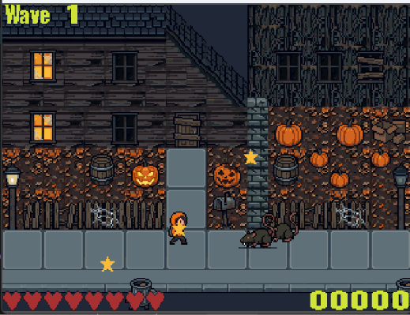

# Spooky Street

## a Zeal 8-bit Computer game by Hardhat

It is the very evening of Halloween and you are out for an innocent walk on your own street.
Despite the familiar territory, things seem different tonight.  Before you know it you are 
attacked by rats, then ghosts then of all things a walking hand.  What is going on here?

## Controls

Use arrow keys (or WASD) to move, space to attack, enter/return to reset the game.

## Collectables

Pumpkins raise your health by 25%

Barrels give you full health

Other items increase your score 50 pts

## Enemies

Rats 100 pts

Ghosts 100 pts

Giant Hand 1000 pts

## Strategy

Enemies come in waves.  Be sure to restore your health between waves.  Use the terrain and items 
to your advantage. Well, ghosts can pass through anything.

## Credits

by Hardhat

- Art done in a mixture of Aseprite/Gimp with pixellab.ai assets as well.  
- Text based on Oswald font.
- Level drawn in Tiled
- Code in C, with Visual Studio Code and GitHub Copilot
- Many thanks to Zeal8bit for his wonderful hardware and tools

## Installation

Just drop spookyst.bin and spookyst.zts in any directory, then cd to that directory and start ./spookyst.bin

Requires a base Zeal 8-bit Computer and Zeal VideoBoard with Zeal OS 0.7 or later.